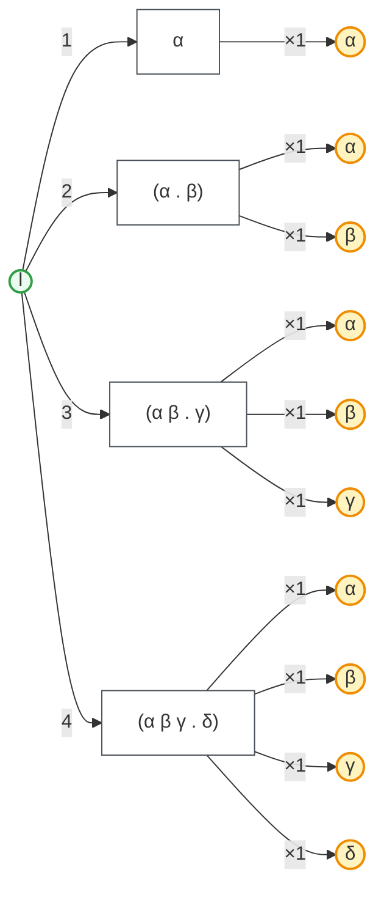
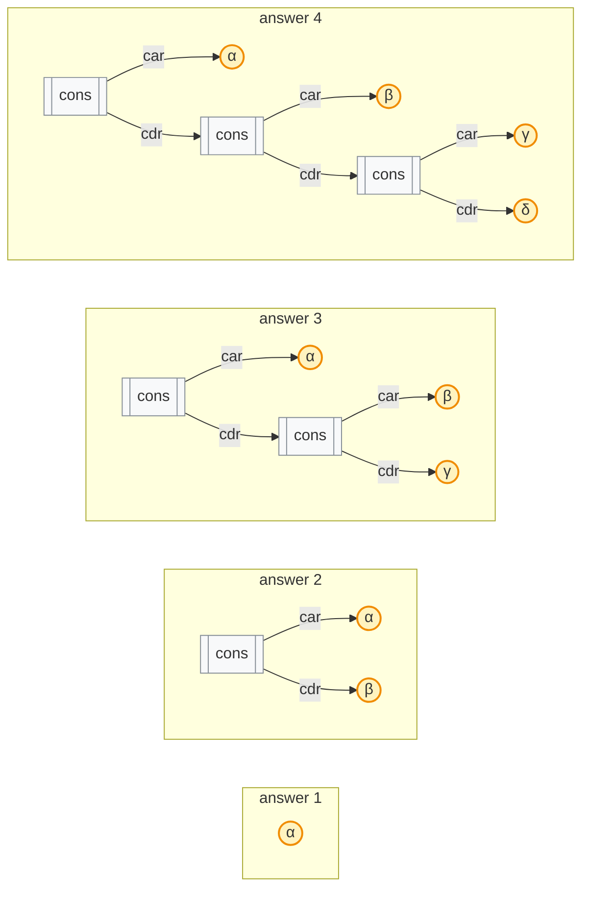

## μKanren query

```scheme
(μkanren-run (l 4 #f) (fresh° (a d) (append° a d l)))
```

**4** answers.

| # | answer |
| --- | --- |
| 1 | `α` |
| 2 | `(α . β)` |
| 3 | `(α β . γ)` |
| 4 | `(α β γ . δ)` |





